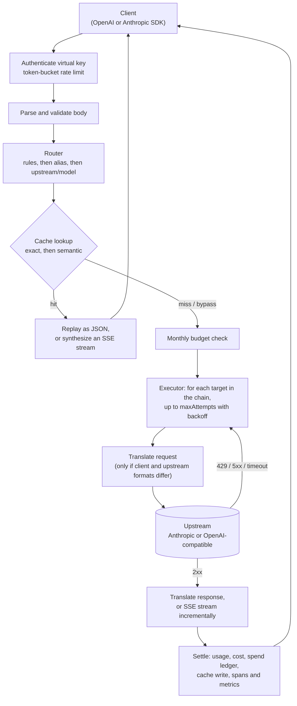

# llm-gateway

[](https://github.com/prakhar083/llm-gateway/actions/workflows/ci.yml)
[](LICENSE)

A self-hostable LLM proxy. Point the official OpenAI or Anthropic SDK at it by changing `baseURL`, and you get:

- **One endpoint, any provider.** OpenAI-compatible `/v1/chat/completions` and Anthropic-compatible `/v1/messages`, both streaming and non-streaming. Requests are translated between the two formats when the client and the upstream disagree, including tool calls and SSE streams.
- **Model routing and fallbacks.** Virtual model names (`fast`, `smart`) map to ordered chains of provider/model targets. Rules can reroute by header, request metadata, or prompt size. Retries use exponential backoff with jitter and respect `Retry-After`.
- **Response caching.** An exact-match cache, plus an optional semantic cache that matches paraphrases of the final user message within a strictly scoped context. Backed by memory or SQLite.
- **Virtual keys with budgets.** Per-key monthly USD budgets, token-bucket rate limits, and model allowlists. Cost is computed from a price table and returned on every response.
- **Observability.** OpenTelemetry traces that follow the GenAI semantic conventions, a Prometheus `/metrics` endpoint, and a structured access log.

It is a single Node.js process with no required external services. Around 3,900 lines of TypeScript, with a test suite that runs the gateway against mock upstream servers and drives the official SDKs through it.

## Contents

- [Quickstart](#quickstart)
- [How a request flows](#how-a-request-flows)
- [Configuration](#configuration)
- [Format translation](#format-translation)
- [Routing, retries and fallbacks](#routing-retries-and-fallbacks)
- [Caching](#caching)
- [Keys, budgets and rate limits](#keys-budgets-and-rate-limits)
- [Observability](#observability)
- [Response headers](#response-headers)
- [Benchmarks](#benchmarks)
- [Development](#development)
- [Design notes](#design-notes)
- [Roadmap](#roadmap)

## Quickstart

The demo stack runs the gateway in front of a bundled mock LLM server that speaks both APIs, with Jaeger collecting traces. You don't need any API keys.

```bash
docker compose up --build
```

| Service | URL |
|---|---|
| Gateway | http://localhost:8080 (demo key `sk-gw-demo`) |
| Jaeger UI | http://localhost:16686 |

Send an OpenAI-format request to `smart`, an alias whose first target is a Claude model:

```bash
curl -i http://localhost:8080/v1/chat/completions \
  -H 'authorization: Bearer sk-gw-demo' -H 'content-type: application/json' \
  -d '{"model":"smart","temperature":0,
       "messages":[{"role":"user","content":"What is the capital of France?"}]}'
```

```
HTTP/1.1 200 OK
x-gateway-route: smart
x-gateway-upstream: mock-anthropic
x-gateway-model: claude-sonnet-5-5
x-gateway-attempts: 1
x-gateway-cache: miss
x-gateway-cost-usd: 0.00020400
x-gateway-budget-remaining-usd: 0.999796
x-ratelimit-remaining-requests: 119

(body abbreviated)
{"id":"chatcmpl-msg_mock","object":"chat.completion","model":"claude-sonnet-5-5",
 "choices":[{"index":0,"message":{"role":"assistant","content":"echo: What is the capital of France?"},
 "finish_reason":"stop"}],"usage":{"prompt_tokens":22,"completion_tokens":16,"total_tokens":38}}
```

The upstream received an Anthropic Messages request, and the client got back a Chat Completions response. If you send `what is the capital of france` next, the response comes back with `x-gateway-cache: semantic-hit`. [`examples/curl.sh`](examples/curl.sh) runs these requests plus a streaming one and a metrics scrape.

With the SDKs, the only change is the base URL:

```ts
import OpenAI from "openai";
const openai = new OpenAI({ baseURL: "http://localhost:8080/v1", apiKey: "sk-gw-demo" });
await openai.chat.completions.create({ model: "smart", messages: [{ role: "user", content: "Hi" }] });

import Anthropic from "@anthropic-ai/sdk";
const anthropic = new Anthropic({ baseURL: "http://localhost:8080", apiKey: "sk-gw-demo" });
await anthropic.messages.create({ model: "fast", max_tokens: 256, messages: [{ role: "user", content: "Hi" }] });
```

[`examples/openai-sdk.ts`](examples/openai-sdk.ts) and [`examples/anthropic-sdk.ts`](examples/anthropic-sdk.ts) show streaming and tool use. They are type-checked in CI, and the same SDK calls are exercised in the test suite.

To use real providers, put your keys in `.env` (see [`.env.example`](.env.example)) and start the stack with the production config:

```bash
GATEWAY_CONFIG=/app/gateway.yaml docker compose up --build
```

You can also run it without Docker: `npm ci && npm run build && node dist/index.js --config gateway.yaml`.

## How a request flows



Every box in the right half is a span in the trace (see [Observability](#observability)). The code follows the same shape:

| Path | Responsibility |
|---|---|
| `src/app.ts` | HTTP routes, auth and rate limiting, error encoding |
| `src/pipeline.ts` | The request lifecycle above |
| `src/routing/` | Rule matching, prompt-size estimate |
| `src/upstream/` | One HTTP attempt with timeouts (`client.ts`), and the retry/fallback executor |
| `src/translate/` | Request, response and stream translation, stream accumulators, SSE synthesis |
| `src/cache/` | Cache planning, embedders, memory and SQLite stores |
| `src/auth/` | Virtual keys, token buckets, spend ledger |
| `src/telemetry/` | Tracer setup, Prometheus metrics, per-request observer |
| `src/testing/` | Mock OpenAI/Anthropic upstream used by tests, benchmarks and the demo |

## Configuration

The gateway reads one YAML file, given by `--config <path>`, `$GATEWAY_CONFIG`, or `./gateway.yaml` by default. Config is validated at startup, and every error is reported with its path.

Secrets come from the environment. `${VAR}` fails startup if `VAR` is unset, `${VAR:-default}` falls back to the default, and `$${VAR}` is a literal. Interpolation runs on the parsed YAML tree, not the raw text, so a secret that contains `:` or `#` cannot change the document's structure.

[`gateway.yaml`](gateway.yaml) is an annotated production example with Anthropic, OpenAI, Groq and Ollama. [`config/gateway.demo.yaml`](config/gateway.demo.yaml) is the keyless demo.

<details>
<summary><b>Full reference</b></summary>

**`server`**

| Key | Default | |
|---|---|---|
| `host` | `0.0.0.0` | |
| `port` | `8080` | May be a string, so `"${PORT:-8080}"` works |
| `bodyLimitBytes` | `10485760` | Larger requests get a 413 |

**`upstreams.<name>`**

| Key | Default | |
|---|---|---|
| `type` | required | `anthropic` or `openai`. `openai` covers any Chat Completions server: OpenAI, Groq, Ollama, vLLM, LM Studio, and others |
| `baseUrl` | required | For `openai`, include the version prefix (`https://api.openai.com/v1`). For `anthropic`, leave it out (`https://api.anthropic.com`) |
| `apiKey` | none | Sent as `Authorization: Bearer` (openai) or `x-api-key` (anthropic) |
| `timeoutMs` | `60000` | Whole request when non-streaming; time to response headers when streaming |
| `headers` | `{}` | Extra headers on every request |
| `anthropicVersion` | `2023-06-01` | anthropic only. `anthropic-version` sent on translated requests. Same-format requests forward the client's header |
| `defaultMaxTokens` | `4096` | anthropic only. Used when an OpenAI-format client omits `max_tokens` |
| `forwardSamplingParams` | `false` | anthropic only. Forward `temperature`/`top_p` from OpenAI-format requests. Off by default because current Claude models reject non-default sampling parameters |
| `maxTokensField` | `max_tokens` | openai only. Set to `max_completion_tokens` for models that require it |

**`models.<alias>`**: `targets` is an ordered list of `upstream/model` strings or `{ upstream, model }` objects. The first target is the primary and the rest are fallbacks.

**`routing`**

| Key | Default | |
|---|---|---|
| `allowDirect` | `true` | Lets clients bypass aliases by sending `model: "anthropic/claude-opus-5-5"` |
| `rules[]` | `[]` | `{ name?, when, route }`. The first matching rule wins and `route` names an alias. `when` combines `model` (string or list), `header` (name to value, or `"*"` for present), `metadata` (keys of the body's `metadata` object), and `minPromptTokens` / `maxPromptTokens` |

**`retry`**

| Key | Default | |
|---|---|---|
| `maxAttempts` | `2` | Attempts per target |
| `baseDelayMs` / `maxDelayMs` | `250` / `4000` | Exponential backoff with full jitter, capped |
| `retryOn` | `[408, 409, 429, 500, 502, 503, 504, 529]` | Timeouts and network errors are always retryable |

**`cache`**

| Key | Default | |
|---|---|---|
| `enabled` | `false` | |
| `ttlSeconds` | `3600` | |
| `maxTemperature` / `defaultTemperature` | `0` / `1` | A request is cacheable only if `temperature ?? defaultTemperature <= maxTemperature` |
| `cacheNonDeterministic` | `false` | Cache regardless of temperature |
| `shareAcrossKeys` | `false` | By default, each virtual key has its own cache partition |
| `store` | `{type: memory, maxEntries: 10000}` | or `{type: sqlite, path}` |
| `semantic.enabled` | `false` | |
| `semantic.threshold` | `0.95` | Minimum cosine similarity for a hit |
| `semantic.ttlSeconds` | `cache.ttlSeconds` | |
| `semantic.embedder` | `{type: hashing, dimensions: 512}` | or `{type: openai, upstream, model, timeoutMs}`, which works with any OpenAI-compatible `/embeddings` endpoint |

**`auth.keys[]`**: `{ name, key, budgetUsdMonthly?, requestsPerMinute?, burst?, models? }`. Once any key is configured, every request must present one (`auth.required` overrides this).

**`budgets.store`**: `{type: memory}` or `{type: sqlite, path}` for the monthly spend ledger.

**`pricing.<model>`**: `{ input, output, cachedInput?, longContext?: { thresholdTokens, input, output } }` in USD per million tokens. A trailing `*` matches a prefix. Prices for `claude-opus-5-5`, `claude-sonnet-5-5` and `claude-haiku-5-5` are built in. You must price every other model you route to.

**`telemetry`**

| Key | Default | |
|---|---|---|
| `serviceName` | `llm-gateway` | |
| `tracing.enabled` | `false` | |
| `tracing.otlpEndpoint` | `$OTEL_EXPORTER_OTLP_TRACES_ENDPOINT` | OTLP/HTTP, e.g. `http://jaeger:4318/v1/traces` |
| `tracing.sampleRatio` | `1` | Parent-based ratio sampling |
| `metrics.enabled` / `metrics.path` | `true` / `/metrics` | |
| `accessLog` | `true` | One JSON line per request, including the trace id |

</details>

## Format translation

The gateway decides whether to translate per request, based on the client's format and the chosen upstream's `type`. When the two match, the body is forwarded with only `model` replaced. Same-format Anthropic requests also forward `anthropic-version` and `anthropic-beta`, so prompt caching, thinking and beta features pass through untouched.

When the formats differ:

| OpenAI Chat Completions | Anthropic Messages |
|---|---|
| `system` / `developer` messages | Joined into top-level `system` |
| `assistant.tool_calls[]` (JSON string arguments) | `tool_use` blocks (parsed `input`) |
| Consecutive `tool` messages | One `user` turn of `tool_result` blocks, followed by any user text. Anthropic requires parallel results in a single turn |
| `tools[].function.parameters` | `tools[].input_schema` |
| `tool_choice`: `auto` / `none` / `required` / named function | `auto` / `none` / `any` / `tool` |
| `parallel_tool_calls: false` | `disable_parallel_tool_use: true` |
| `image_url` (data URL or http URL) | `image` block (`base64` or `url` source) |
| `max_completion_tokens` / `max_tokens` | `max_tokens` (falls back to `defaultMaxTokens`) |
| `stop` | `stop_sequences` |
| `response_format: json_schema` | `output_config.format` |
| `user` | `metadata.user_id` |
| `finish_reason` `stop` / `length` / `tool_calls` / `content_filter` | `stop_reason` `end_turn` / `max_tokens` / `tool_use` / `refusal` |
| `usage.prompt_tokens` (incl. cached) | `input_tokens + cache_read_input_tokens + cache_creation_input_tokens` |

Streams are translated incrementally, event by event, without buffering. Anthropic's `message_start` / `content_block_*` / `message_delta` events become `chat.completion.chunk`s. Each `tool_use` block becomes a `tool_calls` delta with a stable `index`, and its `input_json_delta` fragments become `arguments` fragments. The reverse direction opens and closes content blocks as the OpenAI deltas switch between text and tool calls.

The gateway always asks OpenAI upstreams for `stream_options.include_usage`, because it needs token counts to compute cost. It then removes the usage chunk again for clients that did not request it.

An upstream stream that closes without its terminal event becomes an explicit error event for the client. It is never presented as a clean finish.

Some things are not translated, and the gateway says so instead of guessing:

- `n > 1`, audio and file parts, and Anthropic server tools (web search, code execution) when crossing formats. The request gets a 400. In a fallback chain, a target that cannot express the request is skipped and the next one is tried.
- Thinking blocks are dropped when an Anthropic response goes to an OpenAI-format client, because Chat Completions has no place for them.
- `response_format: json_object` has no Anthropic equivalent and is ignored.
- Sampling parameters are dropped toward Anthropic unless `forwardSamplingParams` is set (see the config reference).

## Routing, retries and fallbacks

The router resolves a request to a `route` (an alias name) and its ordered `targets`:

1. `routing.rules` are evaluated in order, and the first match wins. A rule can override the model the client asked for. For example, `x-gateway-tier: premium` can send any request to `deep`.
2. Otherwise, if the requested `model` is an alias, its chain is used.
3. Otherwise, if `allowDirect` is on, a `model` of the form `upstream/model` is used as a single target.
4. Otherwise, the client gets a 404 in its own error format.

The executor walks the chain:

- Each target gets up to `maxAttempts` tries. The delay before a retry is `random(0, min(maxDelay, base * 2^(attempt-1)))`, and is never shorter than the upstream's `Retry-After`.
- If `Retry-After` is longer than `maxDelayMs`, the gateway moves to the next target immediately instead of holding the client's connection open.
- There is no backoff between targets. A fallback exists to answer quickly, not to wait.
- Timeouts, connection errors and statuses in `retryOn` are retried and then fall over to the next target. Any other 4xx (a malformed request, for example) goes straight back to the client. It would fail on every target, and a 400 from one provider should not quietly turn into a 200 from another.
- Once every target is exhausted, the client gets a 429 if the last failure was a rate limit, a 504 if it was a timeout, and a 502 otherwise. The error message lists each attempt.
- Streaming requests can fall back up to the moment the first byte is sent to the client. After that, an upstream failure is reported in-stream as an error event.

## Caching

Both cache tiers store the final response in the client's format. A hit is returned as JSON or replayed as a synthesized SSE stream, so a response cached from a non-streaming call can serve a streaming client, and the reverse. A streamed response is written to the cache only if the stream completes cleanly.

**Exact tier.** The key is a SHA-256 hash of the canonicalized request. Object keys are sorted, and fields that do not affect the output are removed: `stream`, `stream_options`, `user`, `metadata`. The key also includes the client format, the resolved route and the cache partition.

**Semantic tier.** The gateway embeds the text of the final user message and searches for a stored vector whose cosine similarity is at least `threshold`. The search is restricted to a scope that hashes everything else in the request:

- format, route and cache partition
- system prompt, tools, `tool_choice`
- `max_tokens`, `temperature` and other parameters
- every earlier message in the conversation

The only thing that may differ between a request and a semantic hit is the wording of the last question. A turn whose last message contains images or tool results skips the semantic tier.

**Determinism.** A request is cacheable only if its effective temperature, `temperature ?? defaultTemperature` (default 1, the provider default), is at most `maxTemperature` (default 0). In practice, only requests that explicitly ask for temperature 0 are cached. `cacheNonDeterministic: true` lifts this restriction for workloads where any good answer will do.

Clients can control caching per request with `x-gateway-cache: bypass` (no read, no write) or `x-gateway-cache: refresh` (no read, overwrite).

### Tradeoffs and risks

Exact caching is safe for deterministic requests. It freezes one sample, which is what `temperature: 0` asks for anyway.

Semantic caching trades correctness for cost and latency, and you should enable it with that in mind:

- **False positives are the failure mode.** Embeddings measure topical similarity, not equivalence. "Convert 5 km to miles" and "convert 50 km to miles", or "cheapest flight to Paris" and "most expensive flight to Paris", can score above 0.9 with real embedding models. A semantic hit then returns a confidently wrong answer, with nothing to show it was cached except the response header. Start with a high threshold (0.95 or above), measure the hit rate against wrong-answer reports on your own traffic, and keep semantic caching off for anything involving numbers, entities, or negation that matters.
- **Staleness.** "What's the latest version of X?" asked today and next week are identical. Use a short `semantic.ttlSeconds`, or bypass the cache for time-sensitive routes.
- **Tenant isolation.** A cached answer can carry details from the conversation that produced it. Entries are therefore partitioned per virtual key by default. Turn on `shareAcrossKeys` only when every key belongs to the same trust domain.
- **The bundled `hashing` embedder is lexical.** It uses feature hashing over words and bigrams. It needs no network and handles casing, punctuation and word order, but it has no notion of meaning: "cheap" and "expensive" are just different words. It exists for demos and tests. In production, use a real embedding model through `embedder.type: openai`, which works with OpenAI, Ollama, vLLM or TEI.
- **Embedding cost and latency.** Every cache miss on an eligible request costs one embedding call. That call is not charged to the virtual key's budget. If the embedder fails, the request is treated as a miss and still succeeds.
- **Search is brute force within a scope.** Both stores scan the vectors in a scope linearly. Scopes are small because they include the system prompt and conversation history, so this is fine for thousands of entries per scope. A vector index is on the roadmap.

## Keys, budgets and rate limits

Clients authenticate with a virtual key: `Authorization: Bearer <key>` (what the OpenAI SDK sends) or `x-api-key: <key>` (what the Anthropic SDK sends). Keys are matched by SHA-256 digest, and the client's key is never forwarded upstream. The gateway uses its own provider credentials.

| Check | When | Rejection |
|---|---|---|
| Authentication | Before the body is parsed | 401 `invalid_api_key` / `authentication_error` |
| Rate limit (token bucket, `requestsPerMinute`, `burst`) | Before the body is parsed | 429 with `Retry-After` |
| Model allowlist (`models`) | After routing | 403 |
| Monthly budget (`budgetUsdMonthly`) | After a cache miss, before the upstream call | 402 `insufficient_quota` / `billing_error` |

Every error is returned in the format of the endpoint that was called, so SDKs raise their usual typed exceptions (`RateLimitError`, `AuthenticationError`, and so on).

Cost is `(uncached input × input price + cached input × cachedInput price + output × output price) / 1e6`, using the upstream model that actually served the request. Cache hits cost $0 and are served even when a key's budget is exhausted.

Semantics worth knowing:

- **Budgets are a soft limit.** Spend is checked before a request and recorded after it. Requests that are in flight together can overshoot the budget by their combined cost.
- **Streamed responses are charged when the stream ends.** HTTP headers have already been sent by then, so the cost is appended as an SSE comment (`: x-gateway-cost-usd=0.00014400`). SDKs ignore SSE comments.
- **Unpriced models are counted as $0.** The gateway logs a warning and increments `llm_gateway_unpriced_responses_total`, so a missing price is visible rather than silently free.
- **Rate-limit buckets live in process memory.** With N replicas, each key effectively gets N times its limit. The spend ledger can be shared through SQLite on a shared volume. A Redis-backed limiter and ledger are on the roadmap.

## Observability

### Traces

Enable `telemetry.tracing` and point it at any OTLP/HTTP collector. The compose file sends traces to Jaeger. A request whose primary target fails twice before the fallback succeeds produces this trace:

```
POST /v1/chat/completions                  SERVER  gen_ai.request.model=smart  gen_ai.response.model=claude-haiku-5-5
├── llm_gateway.route                              llm_gateway.routing.targets=[primary/gpt-x, backup/claude-haiku-5-5]
├── llm_gateway.cache.lookup                       llm_gateway.cache.status=miss
├── chat gpt-x                             CLIENT  ERROR  error.type=503  llm_gateway.attempt=1
├── chat gpt-x                             CLIENT  ERROR  error.type=503  llm_gateway.attempt=2
└── chat claude-haiku-5-5                  CLIENT  gen_ai.usage.input_tokens=…  gen_ai.usage.output_tokens=…
```

In Jaeger, the root span's duration covers the whole request. For a stream, it covers the time until the last byte, not just the time to first byte. The failed attempts appear as short red spans, each tagged with the upstream's status code. The span that succeeded carries the token usage, finish reason and response model, and the root span also carries the computed cost.

Attributes follow the [OpenTelemetry GenAI semantic conventions](https://opentelemetry.io/docs/specs/semconv/gen-ai/):

- **Provider:** `gen_ai.provider.name`. The deprecated `gen_ai.system` is emitted alongside it for backends that still key on it.
- **Operation and request:** `gen_ai.operation.name`, `gen_ai.request.model`, `gen_ai.request.max_tokens`, `gen_ai.request.temperature`.
- **Response:** `gen_ai.response.model`, `gen_ai.response.id`, `gen_ai.response.finish_reasons`.
- **Usage:** `gen_ai.usage.input_tokens`, `gen_ai.usage.output_tokens`, `gen_ai.usage.cache_read.input_tokens`.
- **HTTP:** `server.address`, `http.response.status_code`, `error.type`.

Gateway-specific attributes live under `llm_gateway.*`.

Incoming W3C `traceparent` headers are honored, so the gateway's spans join your application's trace. Each upstream attempt sends its own span context upstream. Prompt and completion content is never recorded.

### Metrics

`GET /metrics` serves Prometheus text format:

| Metric | Labels |
|---|---|
| `llm_gateway_requests_total` | `format`, `route`, `status`, `cache` |
| `llm_gateway_request_duration_seconds` (histogram) | `format`, `route`, `cache` |
| `llm_gateway_time_to_first_token_seconds` (histogram, streams) | `route` |
| `llm_gateway_upstream_attempts_total` | `upstream`, `model`, `outcome` |
| `llm_gateway_upstream_latency_seconds` (histogram) | `upstream`, `model` |
| `llm_gateway_tokens_total` | `upstream`, `model`, `direction` |
| `llm_gateway_cost_usd_total` | `key`, `model` |
| `llm_gateway_unpriced_responses_total` | `model` |
| `llm_gateway_cache_lookups_total` | `result` |
| `llm_gateway_cache_hit_ratio` (gauge) | |
| `llm_gateway_rejections_total` | `reason`, `key` |

Node.js process metrics are included under the same prefix. Some useful queries:

```promql
# fallback rate: share of upstream attempts that failed and were retried or fell over
sum(rate(llm_gateway_upstream_attempts_total{outcome="retryable_error"}[5m]))
  / sum(rate(llm_gateway_upstream_attempts_total[5m]))

# p95 time to first token per route
histogram_quantile(0.95, sum by (le, route) (rate(llm_gateway_time_to_first_token_seconds_bucket[5m])))

# spend per key, month to date
sum by (key) (increase(llm_gateway_cost_usd_total[30d]))
```

`/metrics` is unauthenticated. Expose it only on an internal network. Label cardinality is bounded by your config, with one exception: when `allowDirect` is on, a client holding a valid key can create new `model` label values.

## Response headers

| Header | Meaning |
|---|---|
| `x-gateway-route` | Alias (or `upstream/model`) the request resolved to |
| `x-gateway-upstream`, `x-gateway-model` | Upstream and model that served it |
| `x-gateway-attempts` | Upstream attempts made, including retries and fallbacks |
| `x-gateway-cache` | `hit`, `semantic-hit`, `miss` or `bypass` (present when caching is enabled) |
| `x-gateway-cache-age`, `x-gateway-cache-similarity` | Age in seconds of a cached response, and the cosine similarity of a semantic hit |
| `x-gateway-cost-usd` | Cost of this response (non-streaming; `0` for cache hits) |
| `x-gateway-budget-remaining-usd` | Remaining monthly budget for the key |
| `x-ratelimit-limit-requests`, `x-ratelimit-remaining-requests` | Token-bucket state for the key |

## Benchmarks

These numbers measure the gateway's own overhead, not provider latency. They were measured locally against the bundled mock upstream, which answers instantly (0 ms simulated latency), so any time beyond the mock's baseline is spent inside the gateway: parsing, routing, translation, SSE re-encoding, metrics and cache lookups. Tracing and the access log were off; metrics were on.

Setup: [`bench/run.ts`](bench/run.ts) with [autocannon](https://github.com/mcollina/autocannon), Apple M1 Pro (10 cores), Node 22.22, one gateway process. The mock, the gateway and the load generator all ran on the same machine. Each scenario got a 2 s warm-up and a 10 s measurement.

**32 concurrent connections:**

| Scenario | req/s | mean latency | p99 |
|---|---:|---:|---:|
| Mock upstream direct (baseline) | 43,997 | 0.14 ms | 1 ms |
| Gateway, OpenAI to OpenAI passthrough | 6,011 | 4.8 ms | 11 ms |
| Gateway, OpenAI to Anthropic translated | 6,033 | 4.8 ms | 11 ms |
| Gateway, translated + streaming (SSE) | 2,406 | 12.8 ms | 22 ms |
| Gateway, exact cache hit | 17,617 | 1.2 ms | 3 ms |

**1 connection, sequential.** autocannon's latency figures are not meaningful below a millisecond, so the cost per request is derived as 1000 / req/s:

| Scenario | req/s | ms per request |
|---|---:|---:|
| Mock upstream direct | 16,865 | 0.06 |
| Gateway, passthrough | 3,423 | 0.29 |
| Gateway, translated | 3,523 | 0.28 |
| Gateway, translated + streaming | 1,833 | 0.55 |
| Gateway, exact cache hit | 9,731 | 0.10 |

What this shows:

- An uncontended request adds about 0.2–0.5 ms, which is noise next to an LLM call that takes hundreds of milliseconds or more.
- Translating between formats costs the same as passing through. The dominant cost is the second HTTP hop made with `fetch`, not the JSON rewrite.
- Streaming is the most expensive path. Every SSE event is parsed, translated, accumulated (for usage and caching) and re-encoded through a chain of web `TransformStream`s.
- One process saturates at about 6k non-streaming req/s. Real deployments are bound by provider rate limits long before that. To scale beyond one process, run several replicas, keeping in mind the in-memory rate-limit caveat above.

Reproduce with `npm run build && npx tsx bench/run.ts`. `BENCH_CONNECTIONS` and `BENCH_DURATION` adjust the load.

## Development

```bash
npm ci
npm test            # vitest: unit + integration against mock upstream servers
npm run typecheck   # src, tests, examples and the benchmark
npm run build       # tsc -> dist/
npm run dev         # watch mode with tsx (expects ./gateway.yaml)
npm run mock        # standalone mock upstream on :9090
```

The test suite starts real HTTP mock upstreams on ephemeral ports and makes no provider calls. It covers:

| File | Covers |
|---|---|
| `translate-request.test.ts` | Both request directions: system hoisting, tool round trips with parallel results, tool_choice mapping, images, structured output, and requests that must be rejected |
| `translate-response.test.ts` | Both response directions; stream translation in both directions, including interleaved tool-call deltas; arbitrary chunk boundaries and CRLF; truncated and errored streams; SSE synthesis round trips |
| `proxy.test.ts` | End to end through the HTTP app; the official OpenAI and Anthropic SDKs, streaming and tool use, against the gateway |
| `fallback.test.ts` | Retry and backoff, `Retry-After`, timeouts, dropped connections, non-retryable errors, exhaustion statuses, untranslatable targets, streaming fallback |
| `routing.test.ts` | Rule precedence, header, metadata and prompt-size rules, direct addressing |
| `cache.test.ts` | Exact and semantic hits with a deterministic fake embedder, scoping, determinism rules, directives, TTL, partitioning, memory and SQLite stores |
| `budget.test.ts` | Auth, allowlists, cost math, 402 budgets and month rollover, cache hits over budget, streamed charges, rate limiting, pricing tiers, SQLite ledger |
| `telemetry.test.ts` | Span tree and GenAI attributes, trace-context propagation, stream span lifetime, Prometheus output, TTFT, 499 on disconnect |
| `config.test.ts` | Schema validation, env interpolation, and checks that the shipped configs parse |

CI runs on Node 22 and 24 (typecheck, test, build), then builds the Docker image.

## Design notes

**Why Hono.** Hono is built on web-standard `Request`, `Response` and `ReadableStream`, which is how both the upstream `fetch` and the stream translators work. A streaming response is just a pipeline of `TransformStream`s handed back as a `Response`, with no adapter between Node streams and web streams. Hono's `app.request()` runs the full app in-process, which keeps most integration tests fast and port-free. Fastify would have been the stronger choice if the gateway needed its plugin ecosystem or schema-compiled serialization. A proxy whose hot path is opaque JSON and SSE needs neither.

**No provider SDKs at runtime.** A proxy has to pass through fields it does not understand, and has to control the HTTP layer itself: timeouts, retries, cancellation and trace headers. The wire types in `src/formats/` are deliberately open. The official SDKs are used only as dev dependencies, to prove compatibility in tests and examples.

**Cancellation.** If the client disconnects mid-stream, the gateway cancels the upstream request so the provider stops generating tokens. The request is recorded as a 499.

## Roadmap

- Redis-backed rate limiter, spend ledger and cache store for multi-replica deployments
- Vector index (sqlite-vec or HNSW) for large semantic-cache scopes
- Circuit breaker per upstream, so a failing primary is skipped without paying for a failed attempt each time
- Hedged requests (race a second target after a latency threshold) for latency-sensitive routes
- Automatic `cache_control` insertion for Anthropic prompt caching on long, stable system prompts
- `/v1/embeddings` and `/v1/models` passthrough
- Budget reservations, holding an estimated cost while a request is in flight, to tighten the soft limit
- Admin API for managing keys and inspecting spend without a restart

## License

[MIT](LICENSE) © 2026 Prakhar Vijay
